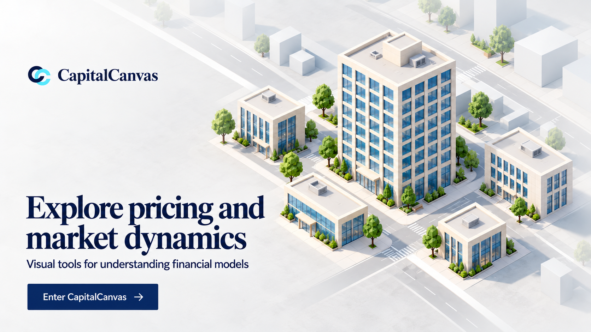

# Selected landing: Grounded District

Status: selected by the user. Discarded landing alternatives have been removed from the project.

Use the high-contrast serif headline, cream/blue daylit tower, continuous pale ground, and fading streets. Keep the main tower dominant and surrounding detail sparse. Extra pale background masses in the generated artwork do not mandate additional runtime buildings.

The selected image and its [generation prompt](concepts/grounded-district-prompt.json) are retained. The visual direction came from `taste-skill:imagegen-frontend-web` and the built-in image generation tool. Exact font identity and runtime performance remain unverified.

See [current visual references and storyboard](VISUAL_REFERENCES.md). The older floating-city storyboard and the adjacent-floor travel frame were superseded. Resources is now planned many storeys below Home.
