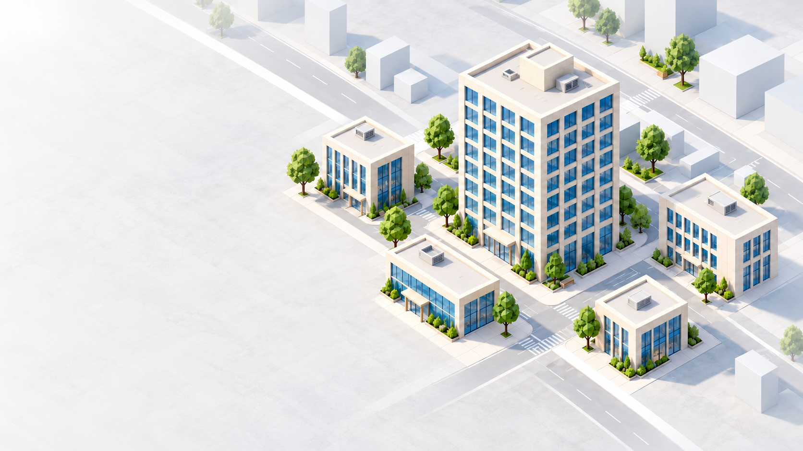
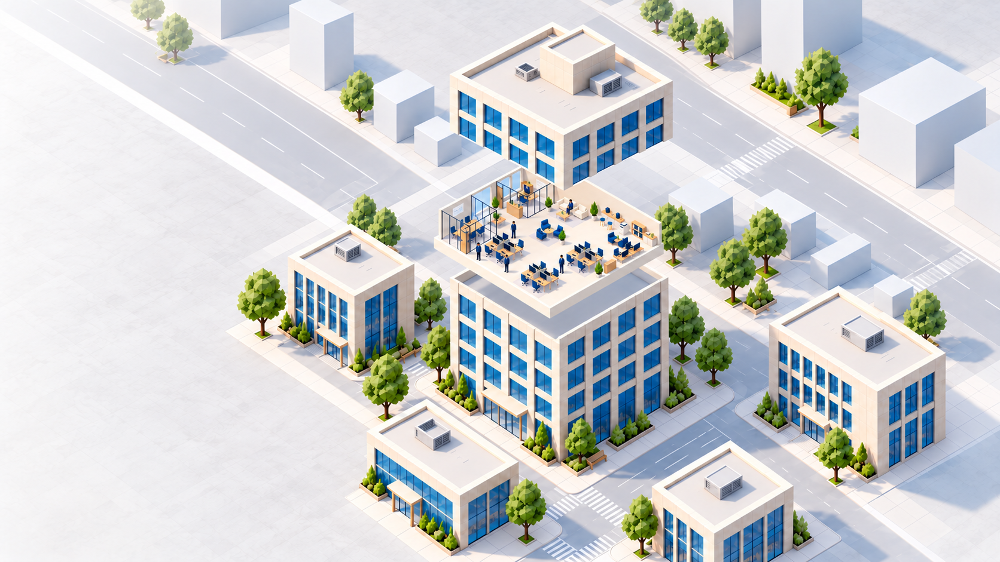
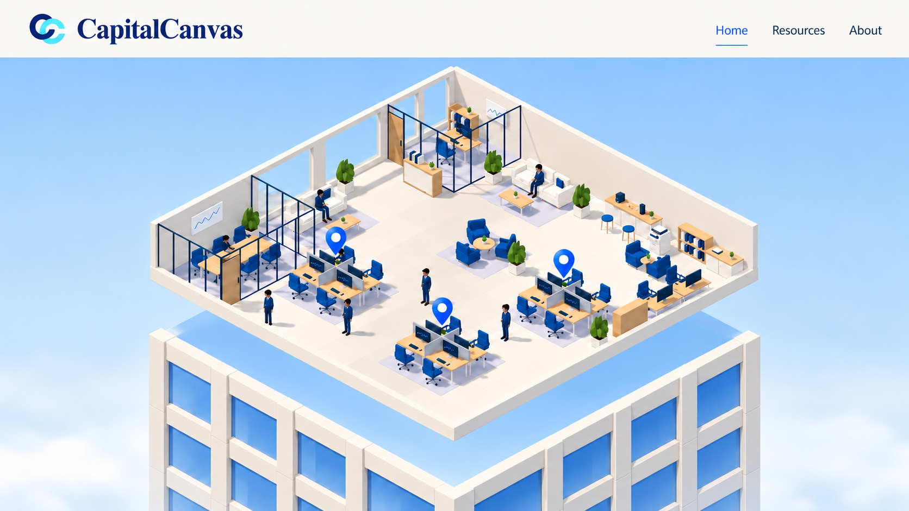
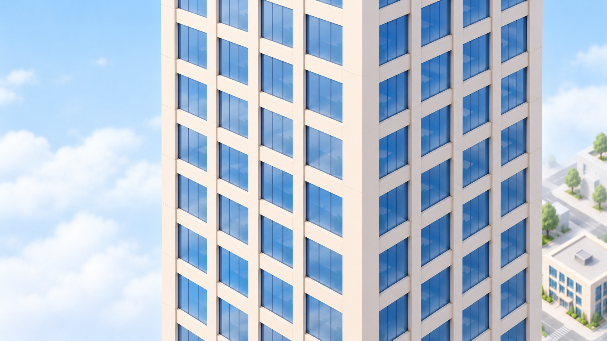
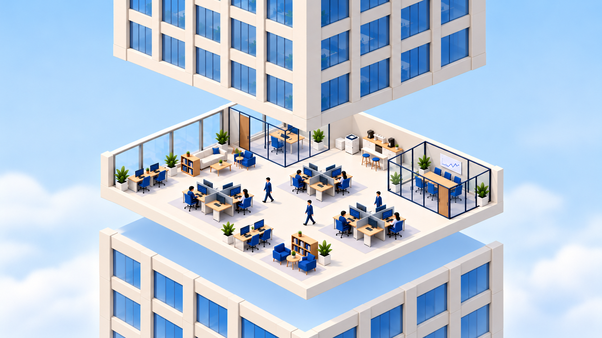
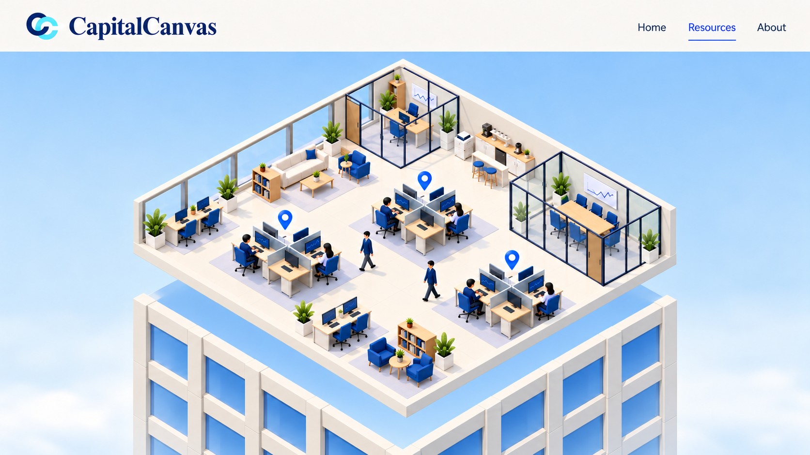
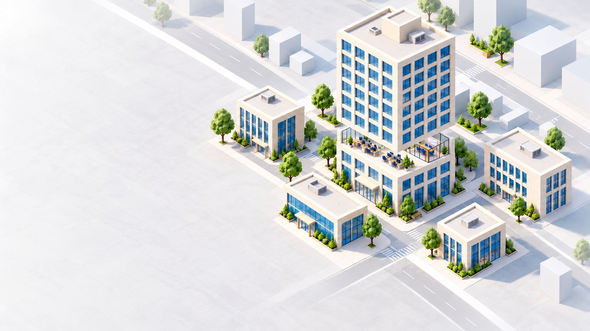

# Grounded District tower storyboard

Grounded District is the selected landing. These seven new reference frames replace the old floating-city storyboard. The supplied [opened preview floor](../references/open-floor-preview.png) establishes Home's layout and the opened-floor rendering language.

Resources is many storeys below Home. Six closed intervening storeys is a proposed starting proportion, to be tuned in the prototype; the generated images are composition and choreography references, not exact measured facade drawings. The journey passes real closed tower structure, then repeats the local three-part opening at Resources.

Structural revision after generation: the live tower now has six fixed storeys below Resources, six closed storeys between Resources and Home, and 16 storeys total. The office origins stay 23.8 m apart. Use the [current motion contract](../TRANSITION.md#current-structure-and-motion-contract) for dimensions and assembly ownership; any short lower base in these older images is superseded. Both office arrival views must show facade continuing below the viewport.

## Closed district

City at rest before entry. Buildings are grounded in a continuous pale district whose streets fade into the page. The [selected landing](../concepts/landing-f-grounded-district.png) adds the wordmark, opening copy, and entrance action to this world.

## Home reveal

During the 2-3 second entrance, lift the cap and expose Home. The remaining tower stays grounded; Resources is still enclosed much farther below. Refine exact section footprint and overhead clearance in the live geometry.

## Home arrival

Arrive at the opened preview Home composition: left conference room, rear private office, three desk markers, and lower facade visible beneath the slab.

## Slide down the facade

Leave Home, close its local opening as it exits view, and slide the camera down past several closed storeys. Resources has not opened yet. This frame makes the physical travel distinct from an adjacent-floor exchange.

## Open distant Resources

At the lower destination, lift the substantial upper tower and raise Resources from the lower base. Home is enclosed far above, outside the close-up. The selected floor stays a thin open slab, using the supplied preview's material and cutaway language. Pins remain hidden during motion.

## Resources arrival

Settle into Resources with its conference room on the right. Show the three markers again only after presentation. Home is far above; it is not the next open slab overhead.

## Reassemble and return

On logo activation, reseat Resources and lower its tall upper assembly while pulling the camera back into Grounded District. Home remains enclosed in that upper structure. Close the one local Resources opening, then restore the selected landing view. Resources-to-Home navigation instead traverses upward along the facade before opening Home.

## Generation record and limits

Generated with the built-in image generation tool under `imagegen` and `taste-skill:imagegen-frontend-web`. Exact prompts and reference inputs are retained in [generation-prompts.json](generation-prompts.json). No runtime code changed.

The Resources destination uses its existing approved arrangement and layout descriptors as secondary references, while the user attachment controls the opened-floor style. Generated furniture/person details remain illustrative; actual preview interiors should be reused in implementation. Stable arrivals include the preview header and pins; structural motion frames omit them for legibility. Exact elevations, clearance, camera continuity, timing, and runtime performance remain prototype checks in the [transition](../TRANSITION.md) and [implementation](../IMPLEMENTATION.md) plans.
