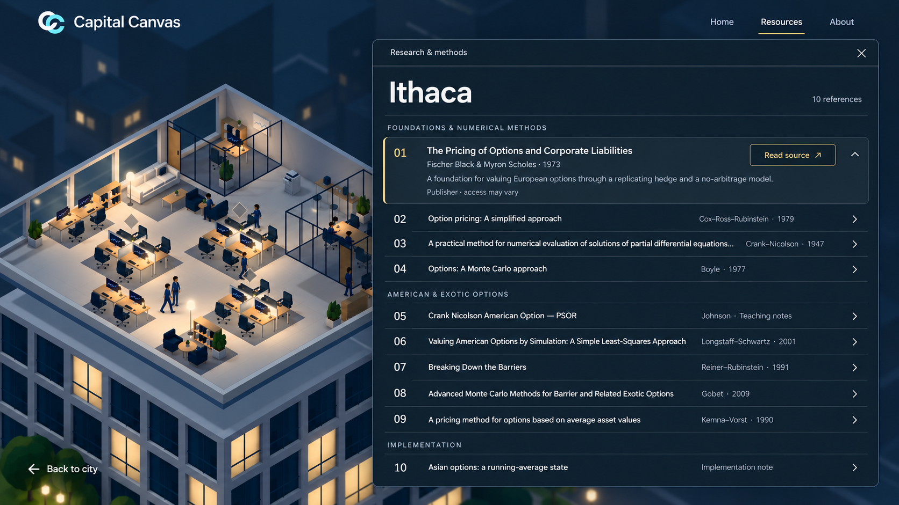

# Ithaca resource window

Historical design/preview record. The office was promoted to `/` on October 16, 2026; see [current office documentation](../office-3d/README.md). Earlier preview-only scope below records the original implementation phase.

Selected floating library, revised October 16, 2026 using taste-skill:imagegen-frontend-web and the built-in image_gen tool.

The navy library opens on the right side of the office preview, retaining the visible office on the left. Its titlebar reads “Research & methods”; the main heading is “Ithaca”. The X is the only close control shown. The earlier footer, Close library button, Esc text, marketing heading/subtitle, duplicate Ithaca titlebar label, and desk callout have been removed.

## Actual page references

- references/actual-office-resources.png: captured from the running local /preview/office#resources page, including the actual CC logo, Capital Canvas wordmark, navigation, office render, markers, and Back to city link.
- references/actual-ithaca-resources.png: captured from the running local /#resources page after expanding Ithaca. The full rendered reference list was also inspected in the browser.

The index retains nine research references and the Asian running-average implementation note. The selected first entry uses the actual title, authors, year, summary, and access label. Collapsed rows illustrate expandable access to the remaining content.

The actual pages supplied the generation inputs; the resulting image remains a generated interpretation rather than an unmodified screenshot. Local page content was verified; production deployment parity was not checked.

## Implemented library

The selected navy styling is implemented for Ithaca, Troy and Delphi in the office preview. The implementation centers the window in the viewport, as requested after selecting the image, without moving or resizing the office. Read research opens it from the existing desk preview. The first reference is expanded, every existing reference and implementation note is retained, and content scrolls inside the window. X, Escape and an outside click close it and return focus to the desk. Original-source links open a new tab. Static fallback offers the same libraries. The generated image above remains the original position/style reference; runtime positioning is centered.

## Implementation verification

All 217 web tests and the production build pass. Lint reports no errors and the existing DelphiSurface hook-dependency warning. Installed Edge through bundled Playwright verified the actual preview at 1440 × 900, 1280 × 720 and 390 × 844: correct tool content/counts (10 / 7 / 6), centered bounds, no horizontal modal overflow, keyboard focus containment/return, all three dismissal methods, internal scrolling, route preservation, and unchanged camera/marker projection on opening and closing, including a zoomed view. The static WebGL fallback opens all three libraries; Home's Open tool destinations and the original Troy resource note remain intact. No browser runtime or console errors occurred. Browser plugin unavailable; temporary QA scripts, results and screenshots are outside the repository. Chromium/Edge was exercised; other browser engines were not tested.

prompts.json records the exact revision prompt and input provenance. Earlier alternative concept PNGs were removed from this folder; their original generations remain in the Codex generated-images directory.

