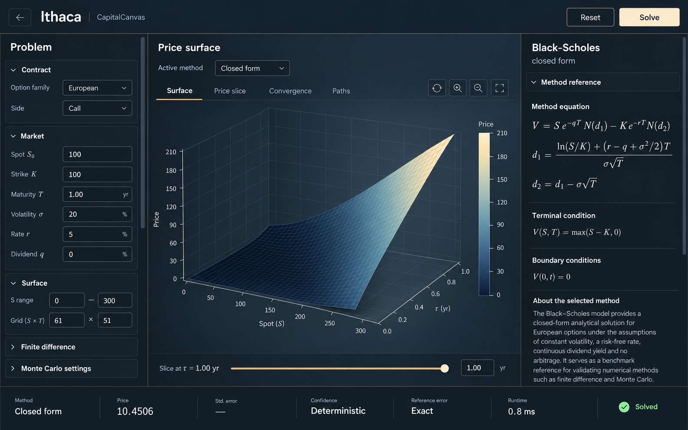

# Ithaca — After Hours

Selected October 16, 2026. Generated with the built-in image generation tool using taste-skill:imagegen-frontend-web.

Deep navy, ivory text and controls, warm fine borders, and refined sans typography carry the Office preview's visual style into Ithaca.

## Implemented workbench

The existing Ithaca workbench now uses the selected design, preserving its left parameter rail, central visualizer, right equation rail, Reset/Solve actions, chart tabs, slice slider, and results strip. The theme reuses the bundled Geist font and is scoped to Ithaca. The header contains Ithaca without the concept's additional CapitalCanvas text. Numerical settings start collapsed and remain available through their existing disclosures.

The existing Plotly renderer uses real computed surface data with a sequential slate-to-ivory palette, matte lighting, and quieter axis guides. Surface mesh lines have been restored with 50% wider spacing than the original After Hours implementation: at the default ranges, spot spacing is 15 instead of 10 and maturity spacing is 0.06 instead of 0.04 years. The 3D viewport fills the space between the tabs and slice bar with no reserved margins; the transparent method legend and vertical price color bar overlay it. All Price tick values, including the starting value, remain visible. An Ithaca-only adapter keeps native Price text attached to the visible axis, placing tick centers 26 CSS pixels to its screen-left and the title 60 pixels left as the camera rotates. It also adjusts the other axes' native 3D text padding for the pinned Plotly 2.35.3 renderer, whose layout API does not expose this spacing. The authored orthographic camera presents spot from left to right with a flatter front edge. The Reset view toolbar action restores this camera, and slice changes retain the user's orbit. Smaller or shorter plotting canvases use reduced scene proportions to keep labels visible. Method comparison curves, exercise boundaries, barrier indicators, and hover values remain intact.

The generated plot, formulas, and labels are illustrative; existing solver data and mathematical rendering remain authoritative.

## Verification

The full web suite passed 205 tests, including a regression check for resetting an orbited chart to its authored camera. The production build passed. Lint has no errors and retains the existing DelphiSurface dependency warning.

Playwright with installed Edge verified real default pricing, Solve after a parameter change, parameter Reset, all chart tabs, active-method switching, camera orbit/reset, slice camera preservation, the American finite-difference exercise boundary, and the barrier plane. Desktop checks covered 1586 × 992, 1440 × 900, and 1280 × 720; mobile checks covered 390 × 844 and all three panels. There was no horizontal page overflow or browser runtime/console error. Troy retained its original typography and media background. Browser plugin unavailable; QA scripts and screenshots remain outside the repository.

The axis and legend follow-up passed 21 focused chart/panel/routing tests and the production build. Edge checks at 1242 × 764 reproduced the 10-year Monte Carlo view and exercised an orbit to the opposite cube edges. Actual WebGL uniform measurements confirmed Price tick centers remain 26 pixels left with no vertical displacement and with the Price zero visible. Desktop and mobile screenshots confirmed separation from the Spot numbers. The full interaction checks passed again with no browser errors. Lint retains only the existing unrelated DelphiSurface warning. The legend remains transparent, and surface mesh spacing remains 15 / 0.06 at default ranges.

## Generation record

References: the Office preview's actual `apps/web/public/office/fallback-city.jpg`, `docs/design/office-redesign/concepts/05-desk-interaction-v2.png`, current Office CSS, and Ithaca workbench components. Local reference images and source inspection informed the concept.

The selected image's exact prompt is saved in `prompts.json`. Unselected concepts have been removed from this folder; original generated images remain in the Codex generated-images directory.

