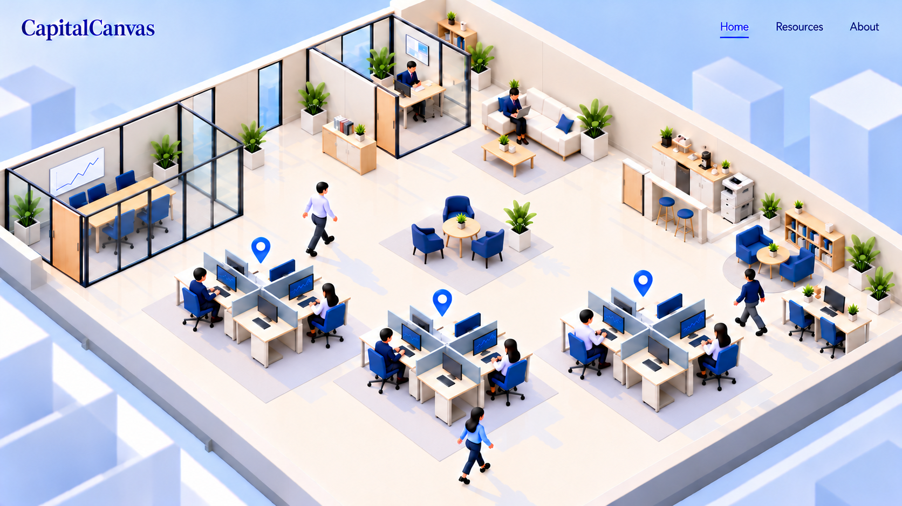
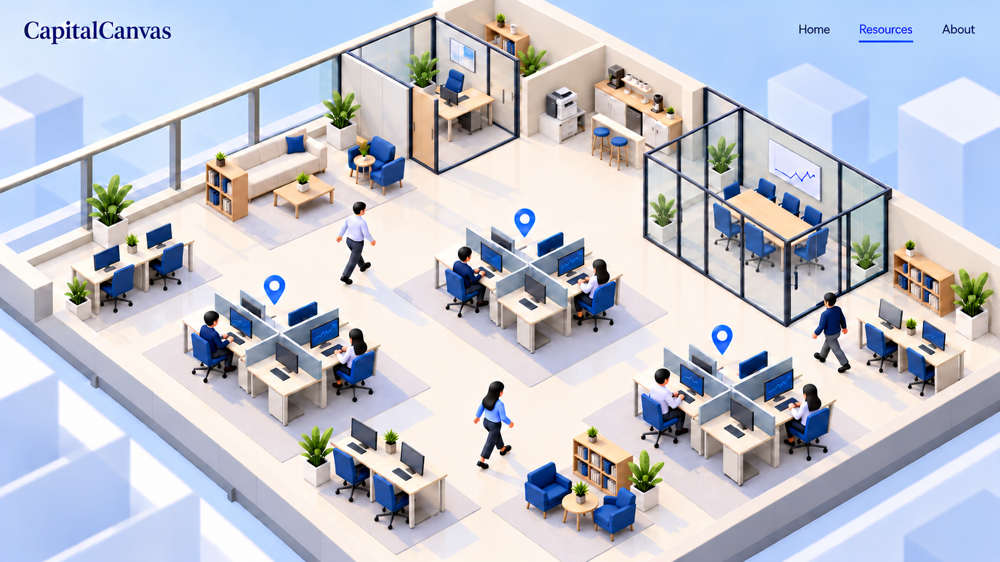

# CapitalCanvas office redesign

Status: functional phases 1–8 and visual stages V0–V7 plus V5A–V5C implemented and verified for the desktop preview. V5C and V6–V7 completed October 14, 2026; reference differences and platform limits are recorded in VISUAL-REVIEW.md. Production migration/mobile/touch design remain separate.

The user authorized the remaining phases after the static surface pass. The preview now includes whole-desk/pin hover and keyboard tool names, header-controlled vertical floor travel, animated GLB workers and staged verification. Tool activation and About remain inert. The existing site is preserved; production migration remains outside scope.

Implemented V5A covers thicker walls/taller front edges, Home Ithaca spacing, northeast shelf/counter, an additional couch/table/rug between Home's glass rooms, the far-left meeting-room tan-door revision, deployed-site nav typography and hover colors. The extra grey band is withdrawn because it already exists. V5B adds cursor-anchored 1–2× wheel zoom, bounded elastic drag and constant-size markers; header-only floor slides reset the view. [VISUAL-REVIEW.md](VISUAL-REVIEW.md) tracks all 30 required findings/checks; [CAMERA-PLAN.md](CAMERA-PLAN.md) defines view controls. Completed stages remain verified checkpoints, not final visual-fidelity approval.

Implemented V5C gives exterior windows thick cream wall-material frames and broad panes above a low sill. Home has two equal middle windows with one narrow cream section and retains its separate private-office split. Resources' four-pane main run stops before its rear glass office, which has one separate broad window. Tall perimeter caps align with existing glass-room mullions at 2.9225m; low front walls, dark interior frames and tan doors remain. Nine clarification answers are recorded in DECISIONS.md.

Implemented V6 replaces blue towers with 33 real instanced cube/prism meshes in 11 asymmetric near/middle/far stepped groups, subtly fogged distance and actual soft shadows on blocks and a pale-blue ground. One camera/environment retains bounded controls and shifts gently with existing floor progress; the ground/stacks clear the complete incoming-floor envelope. No raster scenery, decorative parallax or idle bobbing. Warm/cool daylight, cream tile variation and lilac rugs are refined. V7 verifies both native floors/details/active workers, camera/marker/navigation/lifecycle/fallback, existing routes and same-host performance. [VISUAL-REVIEW.md](VISUAL-REVIEW.md) records captures, live shadow proof, 120 passing tests, build/lint and explicit reference differences. The desktop preview pass is complete.

Open the local preview at `http://127.0.0.1:5173/preview/office#home` or `#resources` after starting `npm run dev:web`. Use Home/Resources header links to switch floors and reset the view. Wheel-up zooms in toward the pointer to 2×, wheel-down returns to centered 1×. Left-drag anywhere in the scene to pan; bounds resist and rebound. Focus the office for +/− zoom, arrow-key pan and 0 reset. Wheel no longer switches floors. Reduced motion selects a stationary floor and freezes workers. The native header stays fixed.

## Approved references

| Page | Saved image | Source generation | SHA-256 |
| --- | --- | --- | --- |
| Home | [home-approved.png](concepts/home-approved.png) | `exec-f6cf52c2-35fa-467a-a1f7-8a89c15c2261.png` | `9A95B35CD6080B61797E375BEDC223B78907D54869F6EC14137802972AFD48D2` |
| Resources | [resources-approved.png](concepts/resources-approved.png) | `exec-67745f87-2910-4a0f-a913-1201d55d9780.png` | `3D34F87BBF266C75D80FD51B6A18C75E10CA51BF3F39F1B12873097E5B587AFC` |

These are unmodified copies of the latest corrected Home image and the most recent Resources image. Earlier variants are superseded. The images were generated with the built-in ImageGen tool and are design references, not finished 3D assets or screenshot-based interfaces.

The user-supplied [deployed navigation crop](references/navigation-deployed.png) is retained separately as the font/size reference for Home, Resources and About. Its dark background and cyan color do not override the office colors, and it does not change the CapitalCanvas wordmark. The two canonical office concepts remain unchanged.

Both floors use one identical 20×20 metre square outer footprint, matching the user's clarification of the references. This replaces the old 22×18 rectangle. Their interiors and northwest window coverage differ. Do not estimate floor dimensions independently from the two images.

The latest Home reference places the long-table meeting room flush into the far-left corner, lowers the middle tool pod relative to the outer two, partly closes the northwest windows, and uses a round table with three armchairs in the center without a bookshelf. The latest Resources reference adds an unmarked foreground workbench and reading nook, and removes the low partitioned storage enclosure beside the printer. These images replace the older references at the same canonical paths; obsolete variants are not retained in the repo.

## Planning documents

- [Follow-up plan: header/logo, cloud wipe, door/corner/glass corrections and remaining differences](REMAINING-DIFFERENCES-PLAN.md)
- [Next visual refinement stages and file map](VISUAL-PLAN.md)
- [Bounded camera interaction and floor-navigation integration](CAMERA-PLAN.md)
- [Visual mismatch ledger and review protocol](VISUAL-REVIEW.md)
- [Design and interaction specification](DESIGN.md)
- [Implementation sequence and acceptance checks](PLAN.md)
- [Confirmed decisions and remaining details](DECISIONS.md)
- [Dependency and character asset inventory](ASSETS.md)
- [Implementation progress and validation](PROGRESS.md)

## Current repository context

The app is React 19, TypeScript and Vite in `apps/web`. The preview adds Three.js 0.182.0, React Three Fiber 9.8.1 and drei 10.7.9, with matching Three.js types. These dependencies are isolated in the lazy preview scene.

`apps/web/src/App.tsx` selects routes and lazy-loads workbenches. `apps/web/src/site/HomePage.tsx` currently renders Home, Resources and About in one scrolling document. `SiteNavigation.tsx` links to `/#home`, `/#resources` and `/#about`. Existing tests explicitly protect this behavior.

The three actual tools are Ithaca, Troy and Delphi. Their current routes are `/tools/ithaca`, `/tools/troy` and `/tools/delphi`. The office preview will not launch these tools yet.

The initial delivery is an isolated preview inside the existing app. The production home, research content, About content, numerical workbenches, policy pages and solver API remain available. No migration is included in this milestone.
