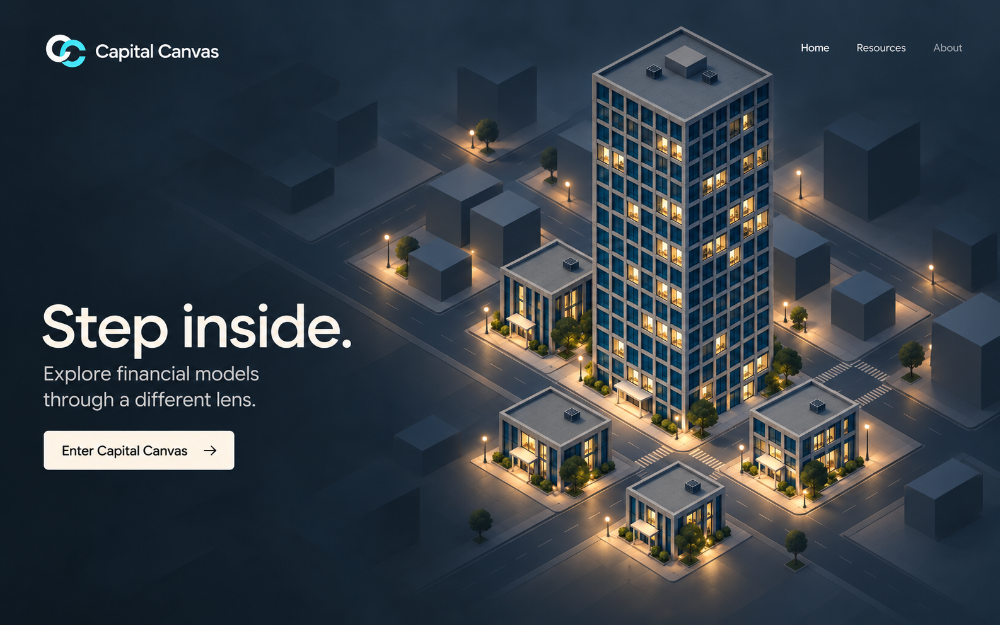
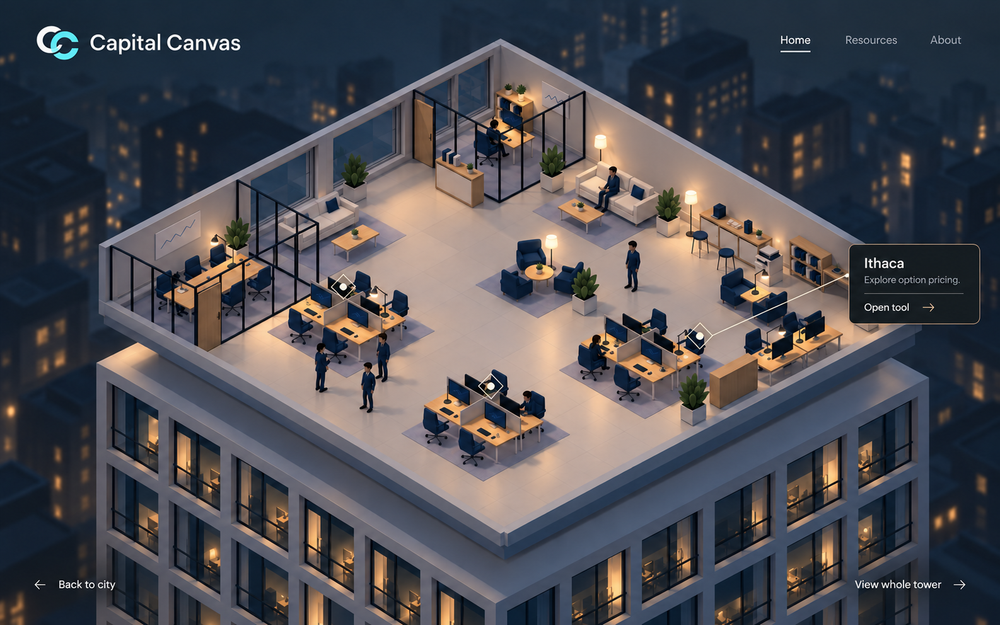
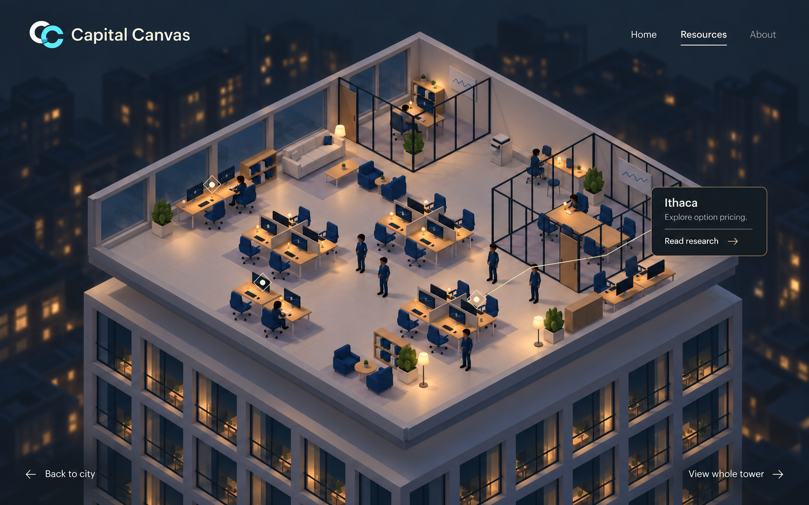
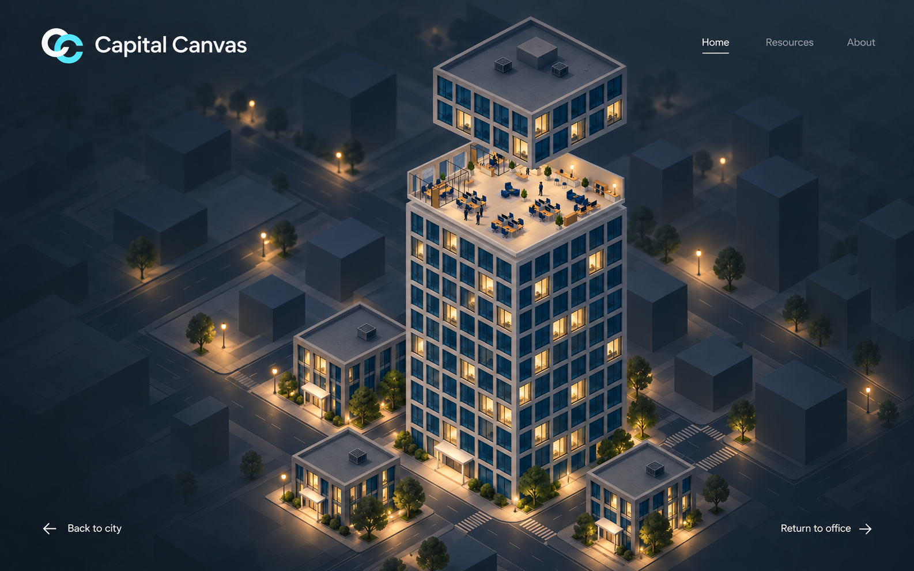
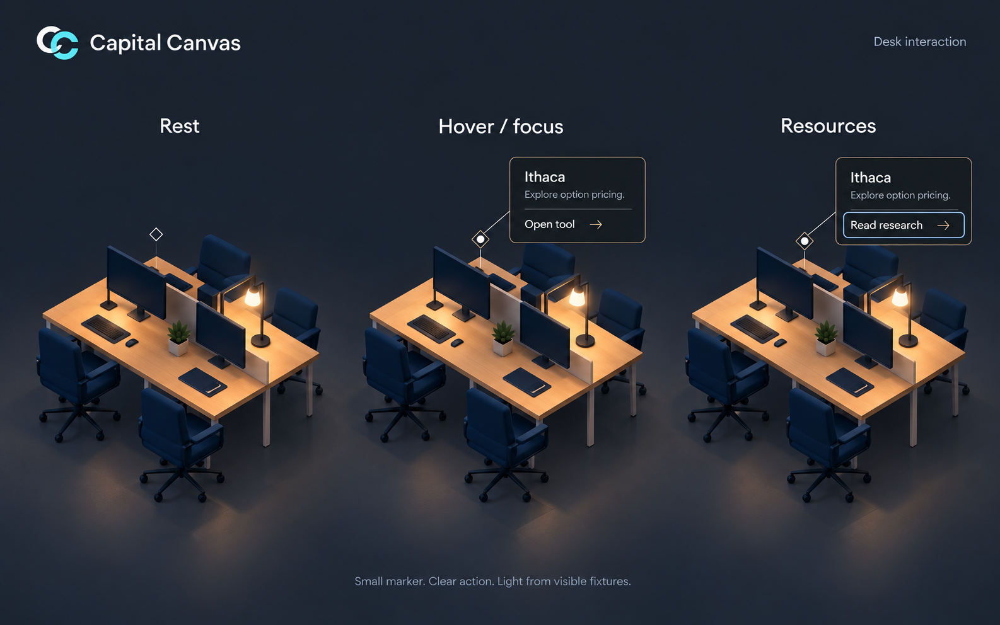

# After Hours visual references

Updated October 15, 2026 using the built-in image-generation tool. These seven images replace the earlier redesign concepts. The [plan](README.md) records the confirmed decisions and next implementation stage.

## Confirmed requirements

- Use the existing white-and-cyan `capital-canvas-logo.png`.
- Home / Resources / About stays at top right on the floors. About opens the selected city-backed editorial note.
- Back to city sits at bottom left. No bottom-middle floor selector or Tools & experiments descriptor.
- Desk task lamps and a few lounge floor lamps explain the light sources.
- Soft warm-neutral ivory interiors contrast with the cooler city. No glowing wall/window strips.
- Home panels use Open tool. Resources keeps the same content and layout but uses Read research.

## City

Compact branding, one entry action and small top-right navigation. The earlier lower-right directory has been removed.

## Home

Top-right navigation, bottom-left city return, bottom-right inspection. Desk lamps and standing lounge lamps provide local lighting. Ordinary window frames and wall bases remain unlit.

## Resources

The actual Resources arrangement supplies the right-side conference room and distinct desk/reading layout. Its panel keeps the same descriptive text and changes the action to Read research.

## Whole-tower inspection

The tower stays grounded in the district; the open Home slice and raised upper assembly remain vertically aligned. Inspection hides the desk markers and offers Return to office at bottom right.

## Desk interaction

This deliberately enlarged detail shows rest, hover/focus and the Resources action. It is an interaction study, not a new page layout. Use the small full-screen diamond scale in implementation, with a larger invisible hit target.

## Entry continuity

See the [four-pose entry sequence](storyboard/README.md): city endpoint, compact opening, zoom and Home endpoint. The two middle poses are separate large images so the visible district and atmosphere remain easy to inspect.

## Review notes and limits

The implemented [About editorial note and plan](about/README.md) retains the same city scene, with a wider dark reading gradient, introduction/contact and compact footer. The two unused alternatives have been removed. The actual scene and supplied logo take precedence over incidental differences in the generated reference.

- The floor lighting received a second pass to remove the old continuous perimeter glow.
- The exact runtime PNG logo takes precedence over slight generative differences in its silhouette.
- Fixed layouts and tower mechanics remain defined by source. Generated furniture, lamp placement, cap height, floor gaps, window counts and city perspective can vary.
- Do not adopt the generator's extra furniture or change the actual scene layout to match an illustration.
- All settled states should use a consistent fine ivory active underline; the zoom frame's cyan underline is an illustrative variation.
- Read research is a proposed action to map to existing content during implementation.
- These references do not prove animation timing, frame-to-frame continuity, performance or crowd clearance. Validate those in the focused live prototype.
- About is now functional; the earlier generated floor references predate that addition.

