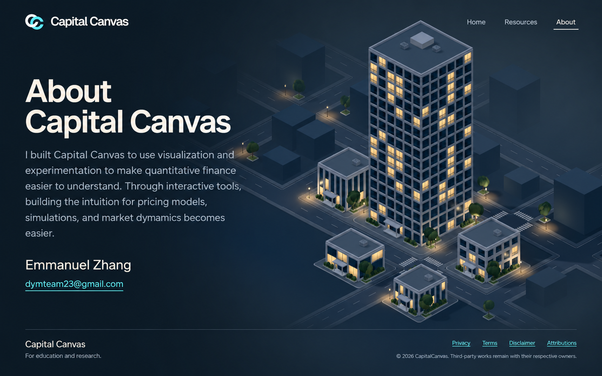

# About: editorial note implementation plan

Historical design/preview record. The office was promoted to `/` on October 16, 2026; see [current office documentation](../../office-3d/README.md). Earlier preview-only scope below records the original implementation phase.

Status: implemented and verified in the isolated office preview on October 15, 2026. This document retains the approved plan and records the resulting checks below.

## Approved reference

Only this reference is retained. The reading-panel and story-band alternatives and their unused prompts have been removed. The selected image was generated with the built-in image tool using the imagegen-frontend-web skill, the actual preview screenshot, the supplied deployed About screenshot and the project logo.

The reference directs typography and content placement. The actual landing scene takes precedence over generated differences in architecture, camera, windows, landscaping or logo details.

## Confirmed decisions

- About uses exactly the same closed city scene as landing: camera/framing, tower and plot setback, streets, buildings, geometry, lighting, exposure, materials, haze depth, bloom and city interactions.
- The only visual differences are the About text/contact, compact bottom bar, active About navigation underline and a wider dark gradient region.
- Keep the logo, wordmark, header dimensions/position and Home / Resources / About placement unchanged.
- Extend the dark field just beyond the reading column, approximately 45–50% of the viewport, then blend softly into the existing brighter city. Preserve the right-hand city's appearance.
- Fit introduction, contact and footer into one desktop viewport, like the editorial reference.
- Landing ↔ About fades text, footer and gradient over a stationary city. No route-triggered zoom, reframe or tower movement.
- Home / Resources → About uses the existing return-to-city choreography, revealing the About content in the final pullback.
- Work stays in /preview/office. Implementation and production integration are separate work.

## Content and layout

Use the existing locally hosted Geist font and current warm ivory, cool-grey and restrained cyan palette. Place the editorial note directly over the left side of the scene with no card, reading panel, glass layer or decorative frame. Align its left edge to the existing landing copy/header grid.

Heading, on two lines:

**About**  
**Capital Canvas**

Body, verbatim:

I built Capital Canvas to make financial models easier to understand through visualization and experimentation. My goal is to help people build intuition for pricing models and market dynamics, whether you're new to quantitative finance or already have experience in the field.

The name and email appear only in the footer, following the user's latest revision.

Use a compact readable block roughly 40% of the viewport wide, capped near 480–500px. Keep the 44–64px responsive heading, 18–20px body text and comfortable 1.45–1.5 leading. Adjust spacing to fit 1280×720 and 1242×764 without shrinking body text into captions. Keep the whole tower visible using the existing camera.

After removing the duplicate contact block, the remaining heading and paragraph sit lower, anchored 20vh from the bottom with a 144–180px range. This keeps clear space above the fixed footer. The header and bottom bar retain their positions.

Replace the landing copy and entry button with this note. Home / Resources navigation and the existing clickable tower still provide entry. The logo returns to landing. About has no new Back to city or inspection controls.

## Bottom bar

Only About shows this compact bottom bar, with a fine top hairline and the same left/right alignment as the header.

Left:
- Emmanuel Zhang
- dymteam23@gmail.com, as a mailto link

Right:

| Label | Existing destination |
| --- | --- |
| Privacy | /privacy |
| Terms | /terms |
| Disclaimer | /disclaimer |
| Attributions | /notices |

Below the links:
© 2026 CapitalCanvas. Third-party works remain with their respective owners.

Implementation should use the current year, matching the existing site footer. Reuse the existing legal destinations without redesigning those pages. Footer links share the top navigation's Geist font, 14px size, 450 weight, cool-grey colour and white hover state, with no permanent underline. Keep the footer visually compact, approximately 80–100px at desktop sizes, with enough clearance for the contact link. No full-width content band above it.

The introduction above uses the user's revised copy and takes precedence over the older reference image. Contact and footer information come from the supplied screenshot and [OfficeSite.tsx](../../../../apps/web/src/site/office/OfficeSite.tsx), [siteInfo.ts](../../../../apps/web/src/site/siteInfo.ts) and [OfficeChrome.tsx](../../../../apps/web/src/site/office/OfficeChrome.tsx). Use their existing contact/legal data without modifying production pages.

## Gradient treatment

The landing's current atmosphere is produced in CityAtmosphere.ts, not by an independent flat CSS background. Its horizontal field supplies both the background and the colour that distant geometry fades into. Keep that relationship continuous on About.

Add a separately controlled About blend to widen the dark reading region. Keep the existing navy and blue-grey colours. Aim for a dark, readable field through approximately the left 45–50%, followed by a broad soft blend. Preserve the existing city glow location and right-side midtone treatment. Tune the mask against the actual text block, without dimming the entire city or changing light sources, exposure, physical fog distances or scene geometry.

The About blend is zero on landing, Home, Resources and both inspection views. Its animation must explicitly invalidate the demand-rendered canvas until completion, then return to the normal render lifecycle. No duplicate canvas or render loop.

Fallback must retain the same city still and apply a matching About-only darkening treatment behind live HTML content. Do not use an image-generated concept as a runtime fallback. Capture a separate still only if the existing city image plus a matched overlay cannot reproduce the reading mask accurately.

## Navigation and motion

Treat About as a page destination over the city, rather than as a new physical floor. Keep the structural views and camera fits as city / home / resources; map About to city at the rendering/motion boundary.

| Journey | Planned behavior |
| --- | --- |
| Direct #about load or refresh | Show the closed city at the existing landing camera, then present About content, footer and active About state. |
| Landing → About | Preserve the current canvas, camera, geometry and city parallax state. Fade out landing copy and fade in About copy/footer with the wider gradient. |
| About → landing via logo | Reverse the content/footer/gradient fade; restore the existing landing text/button at their current lower position. |
| Home / Resources → About | Use the existing 1.55s withdrawal and 1.05s final pullback. Reveal About text/footer and gradient with the final pullback; do not flash landing copy. |
| About → Home / Resources | Use the corresponding existing city-to-floor entry, fading About content/footer/extra darkening out as the journey starts. |
| Rapid navigation or browser history | Latest destination wins; stale scene acknowledgements cannot restore an earlier page. |
| Reduced motion, hidden page or Escape skip | Settle valid content, gradient, active link and camera states immediately. |

Use a short reversible content transition, approximately 250–300ms, for landing ↔ About. This duration is an implementation starting point, not a new tower animation. Preserve ordinary city pointer parallax behavior on both pages; switching pages itself must not reset or move the camera. Structural journey timing, assembly heights, floor light/wall handoffs and inspection behavior stay unchanged.

Separate page/content transition state from the existing structural journey commands. A city-to-About switch must not create a city-to-city tower journey, reset scene resources or remount the canvas. Register #about in hash normalization and history handling. Home should not be marked current while About uses the city scene.

## Implementation sequence (completed)

1. **Page state and navigation.** Extend preview routing with #about; distinguish the selected page from the physical scene view. Preserve history, loading/presentation acknowledgements, skip behavior and stale-intent guards.
2. **Editorial content and footer.** Add an About-specific HTML overlay in the preview using the canonical copy and existing contact/legal data. Activate the About header link and current-page state. Keep all preview selectors scoped.
3. **Atmosphere and content blend.** Connect a reversible About blend to the city compositor and live HTML content/footer. Keep the same camera and scene mounted throughout landing ↔ About.
4. **Floor integration and fallback.** Route floor → About through existing city return, synchronize content with the final pullback, and support direct load and no-WebGL rendering.
5. **Verification and maintained docs.** Test the new route/transition contracts, inspect actual renders and update the current architecture/reference notes to mark About functional after implementation.

Likely ownership:
- useOfficeNavigation.ts: page destination, history and scene mapping.
- OfficeSite.tsx / office.css: active About navigation, editorial note, footer and content visibility/focus.
- OfficeCanvas.tsx / CityAtmosphere.ts: About gradient blend and demand-frame invalidation.
- OfficeFallback.tsx: city-backed About with usable live HTML content.
- Existing navigation, preview and fallback tests: new About coverage.
- Tower motion, geometry, camera fits and layout descriptors: preserve existing behavior; modify only boundary plumbing if necessary.

This is a scope map, not a requirement to edit every listed file.

## Acceptance checks

- Compare landing and About at identical viewport and pointer position: same camera projection, tower/floor/plot transforms, light properties and geometry; only approved overlays, active navigation and gradient mask differ.
- Inspect 1440×900, 1280×720 and 1242×764. All text/contact/footer fit, remain readable and avoid the header, tower and each other.
- Landing's current two-line heading, lower copy/button position and gradient are unchanged.
- Landing ↔ About causes no scene reload, geometry movement, extra zoom or parallax reset; repeated reversals remain smooth.
- Both floors can return directly to About with existing timing; no intermediate landing headline/button flash.
- About can enter both floors and return by history; direct #about, refresh, Back/Forward, resize and rapid retargeting settle correctly.
- About has one exposed H1, aria-current on About, meaningful status/instructions, usable keyboard focus and mailto/legal links. Hidden outgoing content is inert.
- Reduced motion and hidden-page handling complete without lingering animations or hidden content.
- No-WebGL About uses the city still with the correct copy/footer/gradient and functioning navigation.
- Check shader/console errors, focused tests and the normal build/lint gates. Capture final visual evidence only after the implementation is selected and complete.

## Implementation and verification

About is available at /preview/office#about. It uses the same local Office Geist font, 550-weight display/author text, 400-weight body, header grid, ivory/grey palette and restrained cyan links as the other preview pages. A 280ms reversible page blend feeds the live HTML and the existing compositor without remounting the scene. The shade stays strongest through 46% of the viewport and feathers to zero by 62%.

- 34 focused navigation, shell, fallback and tower-motion tests passed. The web build passed; lint has zero errors and the existing unrelated DelphiSurface.tsx dependency warning.
- Browser checks used installed Edge with bundled Playwright because the Browser plugin is unavailable. Actual 3D renders passed at 1440×900, 1280×720 and 1242×764; body text stayed between 18.63px and 20px, with clear header/contact/footer spacing.
- Landing → About retained the same camera UUID, projection, position, scene/geometry/textures, tower transforms, light positions/intensities and exposure on every sampled frame. With UI hidden, the rightmost 36% was pixel-identical; the left reading region changed as intended. Nonzero city parallax was also preserved.
- Both floors returned through the existing withdrawal/final-pullback phases, including Resources inspection → About. About note/gradient followed final camera progress with no landing-copy flash.
- Back/Forward, interrupted/reversed fades, Escape, reduced motion, keyboard/contact focus, hidden-page settling, return retargeting and resize passed. Resources desk disclosure resumed normally with zero About shade.
- With WebGL disabled, About used the existing city JPEG, wider CSS shade and live contact/footer/legal links. Floor → About fallback navigation also passed.

No production homepage/tool pages, global styles, dependencies, geometry, camera fitting, physical lighting or structural journey timing changed. Runtime QA screenshots remain outside the repository; this folder retains only the selected image and maintained plan.
