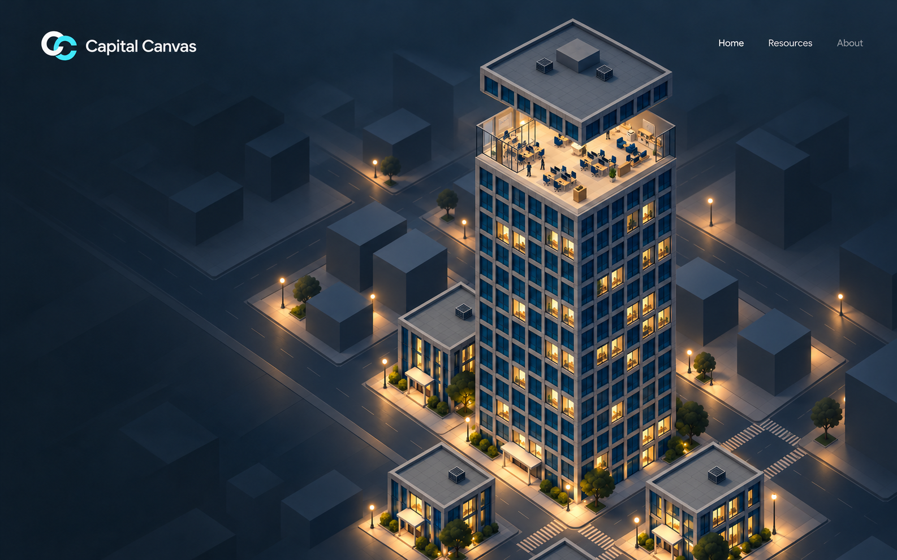

# After Hours entry sequence

This is a framing and atmospheric reference for the existing city-to-Home journey. The four poses form a design sequence; they are not rendered frames from the running app.

## 1. City at rest

The full district is visible. Landing copy and the entry action sit alongside the tower.

## 2. Compact opening

Copy and the entry button have left. The tower opens around Home while the neighbors remain visible.

Implementation contract: preserve the existing equal compact gaps first. The floor rises by 2.2m and upper assembly by 4.4m. The generated illustration approximates these separations and underestimates the cap height; do not copy those proportions into source.

## 3. Zoom toward Home

Move closer along the existing fixed isometric angle. Keep the slice stationary after its initial lift while the upper assembly continues upward out of view. The district remains present at the edges and recedes through distance, framing and haze.

Preserve the original Home layout and use visible task/floor lamps as the light sources. Markers and panels remain suppressed while travel is active. The actual camera endpoint and upper assembly movement remain controlled by the existing choreography.

## 4. Settled Home

Present the full Home composition, resume small desk markers, and expose Back to city and View whole tower. Top-right Home / Resources / About remains in a consistent position. About now opens the city-backed editorial note; this generated sequence predates that addition.

## Motion contract

Preserve the compact reveal followed by zoom. Do not replace the structural animation with cross-fading screenshots or invent another camera path. Keep supporting buildings until they are visually obscured or outside useful framing. Reverse the atmospheric continuity when returning to the city.

The exact geometry, storey counts, gaps, active underline color and motion timing must be consistent in the live implementation even where the generated frames differ. See [current tower motion notes](../../office-3d/MOTION.md) and the [redesign plan](../README.md).

